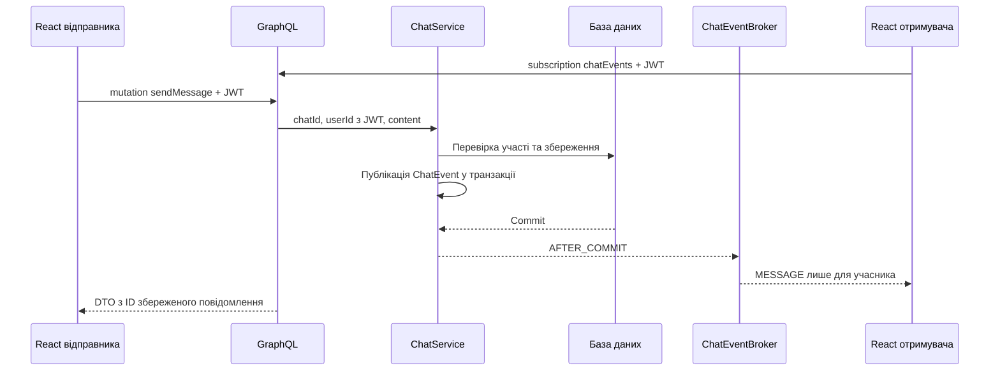

# Архітектура бекенду та GraphQL-чат

## Що проаналізовано

Проєкт використовує Java 21, Spring Boot 4.1.0, Spring MVC, Spring Data JPA,
PostgreSQL, JWT і STOMP/SockJS. Фронтенд — React 19, TypeScript та Vite.
Залежності GraphQL керуються BOM Spring Boot: під час перевірки це Spring
for GraphQL 2.0.4 та GraphQL Java 25.0.

| Модуль | Відповідальність | Результат аналізу та змін |
| --- | --- | --- |
| `auth` | Вхід, реєстрація, JWT | REST-вхід збережено; його JWT використовується і для GraphQL |
| `user` | Обліковий запис, профіль, біографія | Додано перевірку власника в сервісах, хешування нового пароля й приховування пароля у JSON |
| `connection` | Запити і з'єднання користувачів | Додано блокування з'єднання під час конкурентного відкриття чату |
| `recommendation` | Відбір і оцінювання кандидатів | Алгоритм збережено; завантаження всіх кандидатів у пам'ять потребуватиме оптимізації при зростанні бази |
| `chat` | Діалоги, історія, повідомлення, прочитання, набір | Додано GraphQL і перероблено межі контролерів, сервісів, репозиторіїв та подій |
| `shared` | Безпека, WebSocket, конфігурація, помилки, файли | Додано GraphQL-автентифікацію, обробку помилок та ліміти запитів |

Архітектура залишається модульним монолітом. Функціональні пакети збережено;
контролер викликає сервіс, який працює з репозиторіями. GraphQL є новим
адаптером до бізнес-логіки. На GraphQL переведено саме чат. Авторизація,
профілі, рекомендації та з'єднання продовжують працювати через REST.

## Що виправлено

1. Історія чату не перевіряла участь користувача. Тепер `ChatAccessService`
   перевіряє доступ до історії, надсилання, прочитання, набору та підписки.
   REST, STOMP і GraphQL використовують ту саму політику.
2. Історія повертала JPA-сутності зі вкладеним `User`. Тепер історія і список
   чатів вибираються одразу у DTO через JPQL constructor projections.
   GraphQL-схема не містить паролів і вкладеної сутності відправника.
3. WebSocket-контролер сам формував та розсилав повідомлення. Тепер він лише
   викликає сервіс, DTO формує mapper, а доставку виконують окремі слухачі.
4. Події доставляються після успішного commit. Rollback не створює
   «примарних» повідомлень на фронтенді.
5. Паралельні `openChat(A, B)` та `openChat(B, A)` серіалізуються через
   `PESSIMISTIC_WRITE` на з'єднанні. Нові чати зберігають ID пари у сталому порядку.
6. `senderId` визначається з JWT. Вхідний запит не може підмінити автора.
   Порожні повідомлення і текст понад 5000 символів відхиляються.
7. Пагінація обмежена: `page` 0..10000, `size` 1..100. Порядок стабільний:
   `sentAt DESC, id DESC`.
8. Старий STOMP-клієнт не може підписатися на чужий `/topic/chat.*` або
   обійти application handler прямим надсиланням у broker topic.
9. Публічні зміни `/users/**` закрито. Зміни облікового запису, профілю
   і біографії перевіряють власника через `@PreAuthorize` у сервісах.
   Оновлений пароль хешується через `PasswordEncoder`; поле `password`
   має JSON-режим `WRITE_ONLY`.

## Хто за що відповідає

| Компонент | Призначення |
| --- | --- |
| `graphql/chat.graphqls` | Контракт аргументів і відповідей |
| `ChatGraphQlController` | Зв'язує поля схеми з Java-методами |
| `ChatService` | Виконує сценарії в транзакціях та публікує події |
| `ChatAccessService` | Єдина перевірка участі в чаті |
| `ChatMessageMapper` | Перетворює повідомлення на DTO всередині транзакції |
| Репозиторії чату | Запити до БД, DTO-проєкції, пагінація |
| `ChatEvent` | Подія з DTO та ID учасників, без JPA-сутностей |
| `ChatEventBroker` | Передає події після commit підпискам потрібних користувачів |
| `ChatStompEventListener` | Окремий адаптер сумісності зі старими клієнтами |
| `GraphQlAuthenticationInterceptor` | Перевіряє JWT і додає `userId` у GraphQL context |
| `GraphQlExceptionResolver` | Обробляє помилки запитів і потоків підписок |
| `GraphQlConfiguration` | Обмежує глибину запиту до 12, складність до 200 |

Використано Repository, DTO/Mapper, Service Layer, Adapter і подієве
розділення відправника та слухачів. Це рішення для цього проєкту, а не
твердження, що Java зобов'язує застосовувати всі ці патерни. Конструкторні
залежності реалізовані через `final` і Lombok `@RequiredArgsConstructor`.



## GraphQL API

HTTP: `POST /graphql`. WebSocket: `/graphql/ws`, протокол
`graphql-transport-ws`. Це звичайний WebSocket, без STOMP/SockJS.

| Операція | Призначення |
| --- | --- |
| `Query.chats` | Діалоги поточного користувача |
| `Query.chatMessages(chatId, page, size)` | Сторінка історії, найновіші спочатку |
| `Mutation.openChat(participantId)` | ID наявного або нового чату з прийнятим з'єднанням |
| `Mutation.sendMessage(input)` | Зберегти і повернути DTO повідомлення |
| `Mutation.markChatRead(chatId)` | Позначити вхідні повідомлення прочитаними; Boolean показує, чи були зміни |
| `Mutation.setChatTyping(chatId, typing)` | Опублікувати індикатор набору |
| `Subscription.chatEvents(chatId)` | Події `MESSAGE`, `READ`, `TYPING` одного чату |
| `Subscription.chatEvents` | Особисті події всіх чатів користувача |

```graphql
query History($chatId: ID!, $page: Int!) {
  chatMessages(chatId: $chatId, page: $page, size: 30) {
    content { id chatId senderId receiverId content sentAt read }
    last
  }
}
```

Змінні: `{ "chatId": "1", "page": 0 }`.

```graphql
mutation Send($input: SendMessageInput!) {
  sendMessage(input: $input) { id chatId senderId content sentAt read }
}
```

Змінні: `{ "input": { "chatId": "1", "content": "Привіт!" } }`.

```graphql
subscription Events($chatId: ID) {
  chatEvents(chatId: $chatId) {
    kind
    chatId
    message { id senderId content sentAt read }
    receipt { readerId }
    typing { userId typing }
  }
}
```

`chatId: null` означає особисті події всіх чатів. Це не глобальний потік:
broker фільтрує події за ID учасників на сервері.

## Автентифікація та помилки

HTTP передає `Authorization: Bearer <JWT>`. Браузер не дозволяє встановити
довільний HTTP-заголовок WebSocket handshake, тому токен передається так:

```json
{ "type": "connection_init", "payload": { "Authorization": "Bearer <JWT>" } }
```

GET-handshake дозволений без HTTP-токена, але GraphQL-операції вимагають
перевіреного JWT. Перевірка виконується на ініціалізації, перед операцією
і перед доставкою події. Якщо JWT закінчився, наступна доставка завершує
потік помилкою `UNAUTHORIZED`. Потрібно увійти знову. Токен не потрапляє в URL.

Для локального React дозволені конкретні origins `http://localhost:5173`
і `http://localhost:5174`. GraphQL WebSocket має окремі CORS-налаштування
Spring Boot. Для production треба узгодити конкретний origin у
`spring.graphql.cors.*` та `SecurityConfig`.

Очікувані помилки мають `extensions.classification`: `BAD_REQUEST`,
`FORBIDDEN`, `NOT_FOUND`, `UNAUTHORIZED`. Неочікувані помилки залишаються
санітизованими `INTERNAL_ERROR`. GraphQL errors можуть прийти з HTTP 200:
Axios обробляє HTTP-помилки, `GraphQlRequestError` — GraphQL-помилки.

## Реалізація React

`shared/api/graphqlClient.ts` використовує наявний Axios/JWT interceptor для
HTTP та офіційний клієнт `graphql-ws` для підписок. Підписки ділять одне
з'єднання. Apollo-кеш не додавався: hooks проєкту вже керують станом чату.

`chatApi.ts` виконує GraphQL-операції. `chatMapping.ts` перетворює рядкові
GraphQL ID на числові ID наявного UI. `useChatEvents` використовує актуальні
callbacks і скасовує підписку при зміні чату або демонтуванні компонента.

Історія, повідомлення, прочитання, індикатори набору та список чатів працюють
через GraphQL. Online/offline і розрив з'єднань залишаються на STOMP;
відповідні залежності ще потрібні.

Надсилання очікує результат мутації; поле очищається після успіху. Під час
запиту повторне надсилання заблоковане. Помилки показуються у чаті.
Відповідь мутації та подія підписки об'єднуються за ID. Запізніла історія
попереднього чату ігнорується. Після reconnect перечитуються остання
сторінка історії та список діалогів. Logout закриває GraphQL і STOMP.

## Запуск і перевірка

Схема підхоплюється Spring Boot автоматично. Окремий GraphQL-сервер не
потрібен. Після оновлення залежностей перезапустіть бекенд і Vite.

```powershell
cd D:\web\backend
.\mvnw.cmd spring-boot:run
```

```powershell
cd D:\web\frontend
npm ci
npm run dev
```

Типовий `VITE_API_URL` — `http://localhost:8080`. При значенні `/api`
WebSocket URL буде `/api/graphql/ws`; для цього в `/api` proxy треба додати
`ws: true`. Наявний `/api` proxy обробляє HTTP із видаленням префікса.
Окремий `/graphql` proxy вже підтримує WS. Для HTTPS використовується `wss:`.

У наявному `docker-compose.yml` PostgreSQL опубліковано на **5433**, а
`application.properties` вказує **5432**. Для саме цієї Docker-бази перед
запуском бекенду задайте:

```powershell
$env:SPRING_DATASOURCE_URL = 'jdbc:postgresql://localhost:5433/matchme_db'
```

Автоматичні перевірки:

```powershell
cd D:\web\backend
.\mvnw.cmd -B test -Ddebug=false
```

```powershell
cd D:\web\frontend
npm test
npm run build
npm run lint
```

Backend-тести використовують окрему H2-базу у PostgreSQL mode, вимкнений
генератор демоданих і `open-in-view=false`; робочу PostgreSQL не змінюють.
Перевіряються HTTP/JWT, справжній WebSocket з browser Origin, схема через
`WebGraphQlTester`, ізоляція подій, read/typing, rollback, конкурентне
відкриття чату, закінчення JWT, ліміти запитів та захист профілів.
Frontend-тести перевіряють ID, формат подій, передачу JWT і GraphQL errors.

Для ручної перевірки відкрийте дві сесії браузера з різними користувачами,
прийміть запит на з'єднання й відкрийте чат. Перевірте повідомлення в обидва
боки, набір, прочитання, прокручування історії та reconnect. Повний
браузерний E2E-прогін цією зміною не автоматизовано.

## Межі реалізації

- Broker працює в пам'яті одного JVM. Кілька екземплярів бекенду потребують
  спільної доставки через Redis/Kafka або інший broker.
- Durable replay/outbox відсутній. Після рестарту події не відновлюються;
  повідомлення залишаються в БД. Reconnect перечитує останню сторінку,
  а не всю пропущену історію.
- Пагінація сторінкова: при нових повідомленнях її межі можуть зсуватися.
  Дублікати прибираються за ID. Для великих історій доречна cursor/keyset pagination.
- Час збережено як ISO-рядки `LocalDateTime` без часового поясу для сумісності.
  Перехід на UTC/Instant потребує міграції БД та UI.
- Загальні REST DTO профілів, аудит зберігання файлів, масштабування
  рекомендацій і AFTER_COMMIT-події з'єднань — окремі наступні етапи.
  Це не повний аудит безпеки всього застосунку.
- H2-тести не замінюють перевірку на цільовій PostgreSQL. Production потребує
  зовнішніх секретів та керованих міграцій замість `ddl-auto=update`.

## Офіційні джерела

- [Spring Boot: GraphQL](https://docs.spring.io/spring-boot/reference/web/spring-graphql.html) — starter, SDL, MVC, WebSocket.
- [Spring GraphQL: Controllers](https://docs.spring.io/spring-graphql/reference/controllers.html) — mappings та context.
- [Spring GraphQL: Transports](https://docs.spring.io/spring-graphql/reference/transports.html) — HTTP, graphql-ws, interceptors.
- [Spring GraphQL: Execution](https://docs.spring.io/spring-graphql/reference/request-execution.html) — помилки й потоки.
- [Spring GraphQL: Testing](https://docs.spring.io/spring-graphql/reference/testing.html) — GraphQlTester.
- [Spring: Dependency Injection](https://docs.spring.io/spring-framework/reference/core/beans/dependencies/factory-collaborators.html) — конструкторні залежності.
- [Spring: Transaction-bound Events](https://docs.spring.io/spring-framework/reference/data-access/transaction/event.html) — AFTER_COMMIT.
- [Spring Data JPA: Projections](https://docs.spring.io/spring-data/jpa/reference/repositories/projections.html) — DTO-проєкції.
- [Spring Data JPA: Locking](https://docs.spring.io/spring-data/jpa/reference/jpa/locking.html) — @Lock.
- [Spring Security: Method Security](https://docs.spring.io/spring-security/reference/servlet/authorization/method-security.html) — захист сервісних методів.
- [Spring Security: Password Storage](https://docs.spring.io/spring-security/reference/features/authentication/password-storage.html) — PasswordEncoder.
- [GraphQL Java: Instrumentation](https://www.graphql-java.com/documentation/instrumentation/) — контроль виконання.
- [graphql-ws: Recipes](https://the-guild.dev/graphql/ws/recipes) — клієнт і підписки.
- [React: Effects](https://react.dev/learn/you-might-not-need-an-effect) — стан і зовнішні системи.
